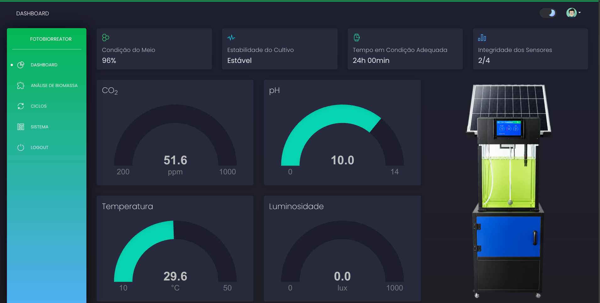
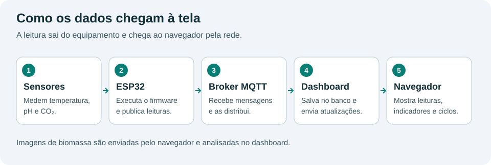

# Fotobiorreator

Sistema para acompanhar um cultivo por sensores e analisar imagens da biomassa.

- **Firmware:** programa do ESP32 que lê sensores e controla os atuadores locais.
- **Dashboard:** aplicação web para acompanhar leituras, ciclos de cultivo e imagens.



> Painel principal: indicadores do cultivo e leituras dos sensores do fotobiorreator. Os valores representam o momento da captura.



O broker MQTT é o serviço que recebe as mensagens do ESP32 e as entrega ao dashboard.
A análise de imagens acontece no dashboard e não depende do ESP32.

## Por onde começar

| Quero… | Leia |
| --- | --- |
| Instalar e usar a aplicação web | [Dashboard](dashboard/README.md) |
| Configurar e gravar o ESP32 | [Firmware](firmware/README.md) |
| Entender onde alterar a aplicação | [Manutenção do dashboard](dashboard/docs/manutencao.md) |

## Pastas

```text
Fotobiorreator/
├── dashboard/   Aplicação web, dados de treinamento e interface
└── firmware/    Controlador principal e testes de componentes
```

Os dois módulos são preparados separadamente. Para receber leituras, configure ambos
para usar o mesmo broker, prefixo MQTT e IDs de sensores.

A interface deriva do Black Dashboard / AppSeed. Consulte a
[licença incluída no dashboard](dashboard/LICENSE.md).
