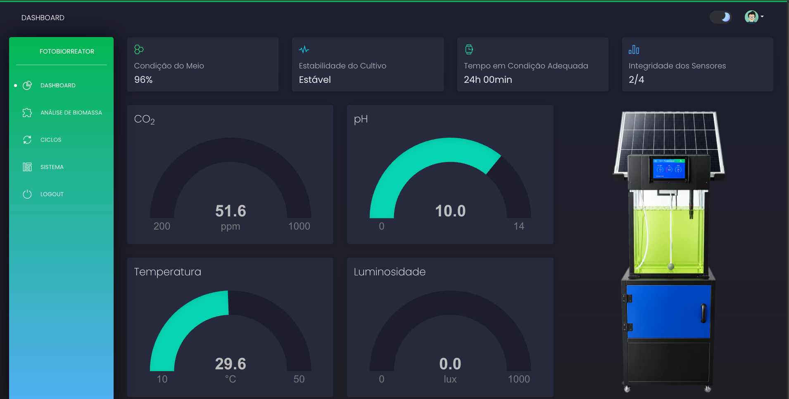
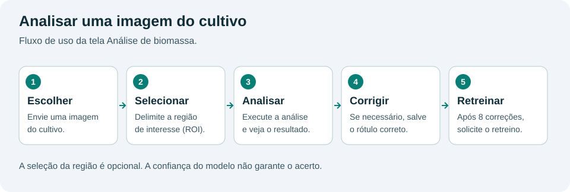

# Dashboard do fotobiorreator

Aplicação web para visualizar sensores em tempo real, acompanhar ciclos de cultivo
e analisar imagens da biomassa. Usa Python e Flask.

[Visão geral do sistema](../README.md) · [Firmware](../firmware/README.md) · [Manutenção](docs/manutencao.md)

## Executar no computador

Os comandos abaixo usam terminal de macOS/Linux e partem da raiz do repositório.
Use Python 3.12. Para receber leituras reais, também é necessário um broker MQTT acessível.

### 1. Preparar o ambiente

```bash
cd dashboard
python3.12 -m venv .venv
source .venv/bin/activate
python -m pip install -r requirements.txt
cp -n env.sample .env
```

Se já existir um `.env`, mantenha-o e edite apenas o necessário.
No VS Code, selecione `dashboard/.venv/bin/python` como interpretador.
No Windows, a ativação é `.venv\Scripts\Activate.ps1` no PowerShell.

### 2. Configurar

Edite `.env`:

```dotenv
DEBUG=True
FLASK_APP=run.py
SECRET_KEY=troque-por-uma-chave-local-aleatoria
ASSETS_ROOT=/static/assets
MQTT_ENABLED=false
MQTT_REQUIRED=false
```

Essa configuração permite abrir a aplicação sem receber dados de sensores.
Para gerar uma chave, execute `python -c "import secrets; print(secrets.token_hex(32))"`
e copie o resultado para `SECRET_KEY`.

Para receber leituras, use:

```dotenv
MQTT_ENABLED=true
MQTT_REQUIRED=false
MQTT_BROKER=127.0.0.1
MQTT_PORT=1883
MQTT_TOPIC=cba_fotobiorreator/sensors/+/data
```

Substitua o endereço pelo computador que executa o broker. O prefixo
`cba_fotobiorreator` deve ser igual a `MQTT_NAMESPACE` no firmware.
Com `MQTT_REQUIRED=false`, uma falha de conexão não impede a abertura da aplicação.

### 3. Preparar o banco

O banco padrão é `apps/db.sqlite3`. Se você já tem um banco configurado, preserve-o.

**Somente em uma instalação nova, sem banco existente:**

```bash
python -m flask --app run shell
```

No shell Python:

```python
from apps import db
db.create_all()
exit()
```

Isso cria as tabelas atuais, mas não cadastra usuários nem sensores e não atualiza
tabelas antigas. O histórico de migrações não está versionado neste repositório;
por isso, `flask db upgrade` sozinho não prepara uma cópia nova.
Para mudanças em bancos existentes, consulte [Manutenção](docs/manutencao.md#banco-e-arquivos).

### 4. Iniciar

```bash
python run.py
```

Abra **http://127.0.0.1:5000**, crie uma conta em **Cadastrar** e faça login.
Para iniciar novamente em outro terminal, entre em `dashboard`, ative a `.venv`
e execute `python run.py`.

Os arquivos CSS e JavaScript utilizados já estão no repositório. Não é necessário
executar npm para abrir a interface atual. O build frontend precisa de revisão
antes de ser usado; veja [Manutenção](docs/manutencao.md#limitações-e-pendências).



> Painel principal: indicadores do cultivo e leituras dos sensores do fotobiorreator. Os valores representam o momento da captura.

## Usar a aplicação

| Tela | Para que serve |
| --- | --- |
| Dashboard | Leituras dos sensores e indicadores do cultivo |
| Análise de biomassa | Enviar imagem, analisar e corrigir a classificação |
| Ciclos | Iniciar e finalizar períodos de acompanhamento; consultar seus resumos |
| Sistema | Consultar conta, conexão MQTT e resumo dos dados |

### Sensores

As mensagens MQTT só são salvas quando o `sensor_id` já existe no banco.
Uma instalação nova começa sem sensores. Consulte o
[cadastro inicial e o mapa de IDs](docs/manutencao.md#cadastrar-sensores-em-uma-instalação-nova).

Fluxo de uma leitura: **ESP32 → broker MQTT → banco → atualização do navegador**.
Sem dados, os componentes podem ficar vazios ou neutros. Os indicadores usam regras
locais de temperatura e pH; não equivalem a uma validação científica do cultivo.
As regras estão em `apps/services/kpi_service.py`.

### Análise de biomassa



1. Abra **Análise de biomassa** e selecione uma imagem do cultivo.
2. Se necessário, delimite a região que contém o cultivo. Essa seleção é chamada de **ROI**.
3. Clique em **Analisar biomassa** e confira a classe e a confiança retornadas.
4. Se a classe estiver incorreta, selecione o rótulo correto e salve a correção.
5. O retreino fica disponível pelo fluxo da tela; o backend exige ao menos oito registros com rótulo manual.

Na primeira análise, o modelo é treinado com o CSV incluído caso ainda não exista
um modelo salvo. As imagens e correções permanecem no computador que executa a aplicação.
A confiança é uma saída do modelo, não uma garantia de acerto.

### Ciclos de cultivo

Inicie um ciclo para agrupar as leituras recebidas naquele período. Ao finalizar,
o resumo permite consultar os sensores e seus valores. Um ciclo sem leituras
aparece sem métricas. Os horários da interface usam o fuso de Manaus.

O ciclo do dashboard é um registro de acompanhamento. O agendamento dos atuadores
é executado separadamente pelo firmware.

## Problemas comuns

| Problema | O que conferir |
| --- | --- |
| `ModuleNotFoundError` | Ative a `.venv` e confira a instalação de `requirements.txt` |
| Erro de `libomp` ao importar XGBoost no macOS | Instale a biblioteca OpenMP com `brew install libomp` |
| `no such table` | Confira o banco usado; para instalação nova, siga a etapa 3 |
| Nenhuma leitura | Confira o estado em Sistema, o broker, o tópico e os IDs cadastrados |
| Retreino recusado | Salve pelo menos oito classificações manuais e confira a mensagem retornada |
| Interface incompleta sem internet | Parte das fontes e bibliotecas visuais é carregada de serviços externos |

Docker e Gunicorn ainda têm diferenças em relação à inicialização local do tempo
real. O caminho descrito aqui é o de desenvolvimento com `python run.py`.

## Créditos

Interface derivada de Black Dashboard / AppSeed. [Licença](LICENSE.md).
